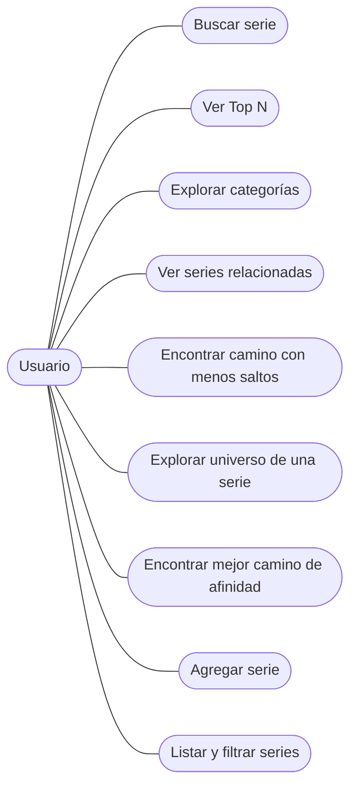

# Casos de uso — CrossVerse

## Diagrama

## Descripción de los casos de uso

### CU01 — Buscar serie
**Actor:** Usuario
**Precondición:** el catálogo está cargado.

**Flujo principal:**
1. El usuario elige "Buscar serie".
2. El sistema solicita el título.
3. El usuario ingresa el título (en mayúsculas o minúsculas).
4. El sistema busca en el AVL y muestra la serie encontrada.

**Flujo alternativo:** si el título no existe, el sistema muestra "No se encontró". La búsqueda es por título completo, no parcial.

### CU02 — Ver Top N
**Actor:** Usuario
**Precondición:** el catálogo está cargado.

**Flujo principal:**
1. El usuario elige "Top N series más recientes".
2. El sistema pregunta cuántas series quiere ver.
3. El usuario ingresa N.
4. El sistema obtiene las N series de mayor prioridad (año de estreno) desde la heap y las muestra numeradas, de la más reciente a la más antigua.

**Flujo alternativo:** si N es mayor que la cantidad de series, el sistema muestra todas.

### CU03 — Explorar categorías
**Actor:** Usuario
**Precondición:** el catálogo está cargado.

**Flujo principal:**
1. El usuario elige "Explorar categorías".
2. El sistema recorre el árbol general por amplitud y muestra la raíz, las décadas, los años y los títulos.

**Nota:** las series agregadas durante la ejecución aparecen en esta vista recién al reiniciar el programa.

### CU04 — Ver series relacionadas
**Actor:** Usuario
**Precondición:** el catálogo está cargado.

**Flujo principal:**
1. El usuario elige "Series relacionadas".
2. El sistema solicita el título de una serie.
3. El usuario lo ingresa.
4. El sistema localiza la serie en el AVL, consulta sus vecinos en el grafo y los muestra ordenados de mayor a menor peso de relación.

**Flujos alternativos:** si la serie no existe, el sistema avisa; si no tiene vecinos, muestra "No tiene series relacionadas".

### CU05 — Encontrar camino con menos saltos
**Actor:** Usuario
**Precondición:** el catálogo está cargado.

**Flujo principal:**
1. El usuario elige "Camino entre dos series (BFS)".
2. El sistema solicita la serie de origen y la de destino.
3. El sistema localiza ambas en el AVL y ejecuta BFS sobre el grafo.
4. El sistema muestra la secuencia de series intermedias y la cantidad de saltos.

**Flujos alternativos:** si alguna serie no existe, el sistema avisa; si no hay conexión entre ellas, muestra "No hay conexión entre esas series".

### CU06 — Explorar universo de una serie
**Actor:** Usuario
**Precondición:** el catálogo está cargado.

**Flujo principal:**
1. El usuario elige "Explorar universo de una serie (DFS)".
2. El sistema solicita la serie de origen.
3. El sistema ejecuta DFS sobre el grafo desde esa serie.
4. El sistema muestra todas las series alcanzables, en el orden de visita.

**Flujo alternativo:** si la serie no existe, el sistema avisa.

### CU07 — Encontrar mejor camino de afinidad
**Actor:** Usuario
**Precondición:** el catálogo está cargado.

**Flujo principal:**
1. El usuario elige "Mejor camino de afinidad".
2. El sistema solicita la serie de origen y la de destino.
3. El sistema localiza ambas en el AVL y ejecuta Dijkstra con costo 1/peso.
4. El sistema muestra el camino de menor costo y el costo total.

**Flujos alternativos:** si alguna serie no existe, el sistema avisa; si no hay conexión, muestra "No hay conexión entre esas series".

### CU08 — Agregar serie
**Actor:** Usuario
**Precondición:** el catálogo está cargado.

**Flujo principal:**
1. El usuario elige "Agregar serie".
2. El sistema solicita título, creador, año y género.
3. El usuario los ingresa.
4. El sistema crea la serie y actualiza el grafo, el listado, el AVL y la heap.
5. El sistema confirma que la serie fue agregada.

**Postcondición:** la serie aparece en la búsqueda, el Top N y las series relacionadas. No se guarda en el JSON.