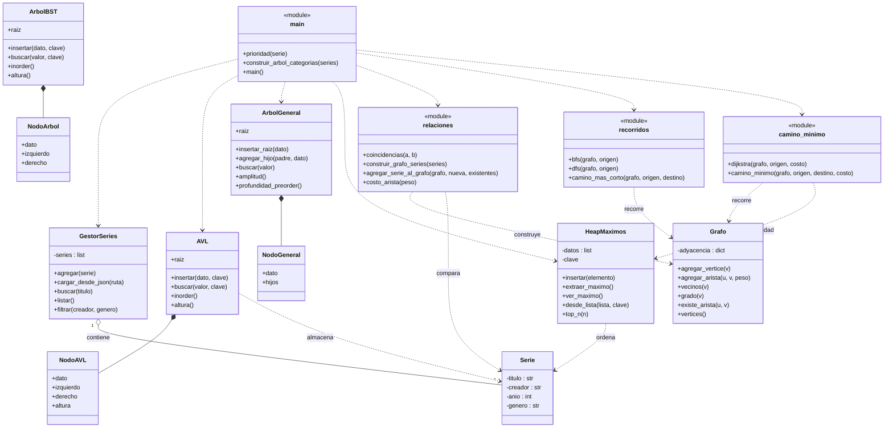

# Diagrama de clases — CrossVerse

## Diagrama

## Relaciones principales

| Relación | Tipo | Significado |
|---|---|---|
| `GestorSeries` — `Serie` | agregación | El gestor contiene la lista de series. |
| `AVL` — `NodoAVL`, `ArbolBST` — `NodoArbol`, `ArbolGeneral` — `NodoGeneral` | composición | Cada árbol está formado por sus nodos. |
| `AVL`, `HeapMaximos` → `Serie` | dependencia | Guardan y ordenan objetos `Serie` usando una función clave. |
| `Grafo` | independiente del dominio | Sus vértices son títulos; `relaciones` decide qué series se conectan y con qué peso. |
| `camino_minimo` → `HeapMaximos` | dependencia | Dijkstra usa la heap propia como cola de prioridad. |

## Notas

- `ArbolBST` quedó de la etapa del árbol binario y se conserva en el repositorio. El menú usa `AVL`.
- Los módulos `relaciones`, `recorridos` y `camino_minimo` contienen funciones, no clases.
- `Serie` expone sus atributos mediante propiedades de solo lectura (encapsulamiento).