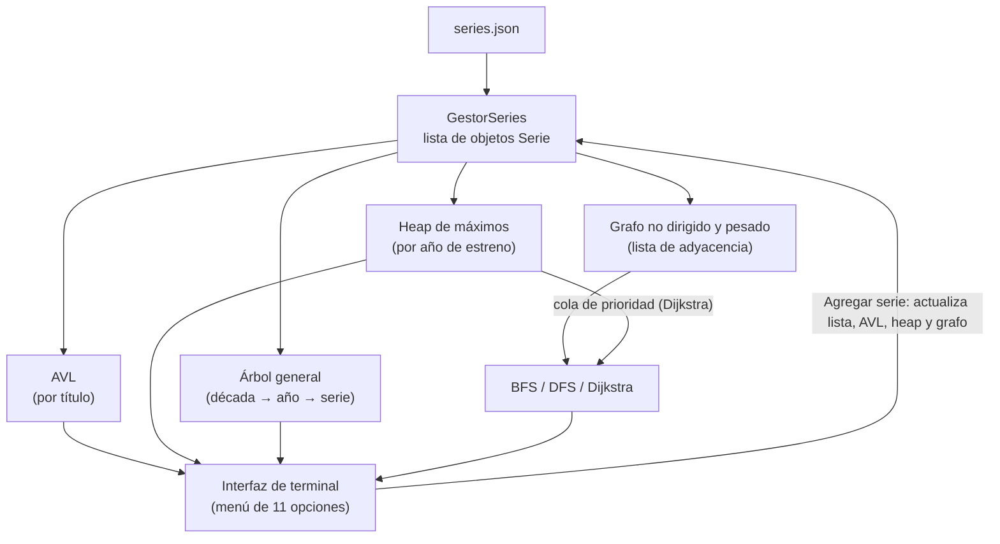

# Diagrama de datos — CrossVerse

Muestra cómo se conectan las estructuras de datos del sistema, desde los datos crudos hasta la interfaz.

## Diagrama

## Qué estructura resuelve cada necesidad

| Estructura | Criterio | Opción del menú | Complejidad |
|---|---|---|---|
| AVL | título en minúsculas | 2 (buscar) y localizar origen/destino en 7, 8, 9 y 10 | búsqueda O(log n) |
| Heap de máximos | año de estreno, mayor primero | 6 (Top N) y cola de Dijkstra | insertar O(log n), Top-k O(k log n) |
| Árbol general | década → año → serie | 5 (explorar categorías) | recorrido O(n) |
| Grafo (lista de adyacencia) | creador o género compartido, peso = coincidencias | 7 (relacionadas) | vecinos O(grado), construcción O(n²) |
| BFS | menos saltos | 8 | O(V + E) |
| DFS | exploración en profundidad | 9 | O(V + E) |
| Dijkstra | costo = 1 / peso | 10 | O((V + E) log V) |

## Flujo de una consulta (ejemplo)

Opción 10, "Mejor camino de afinidad":
1. El usuario escribe dos títulos.
2. El AVL localiza ambas series y devuelve sus títulos exactos.
3. Dijkstra recorre el grafo usando la heap como cola de prioridad.
4. La interfaz muestra el camino y el costo total.

## Flujo de alta de una serie

Opción 1, "Agregar serie":
1. Se crea el objeto `Serie`.
2. Se compara con las series existentes y se agregan sus aristas al grafo.
3. Se agrega a la lista del gestor, al AVL y a la heap.
4. El árbol de categorías no se actualiza hasta reiniciar el programa.