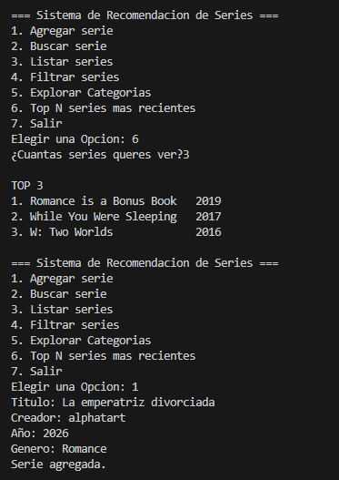
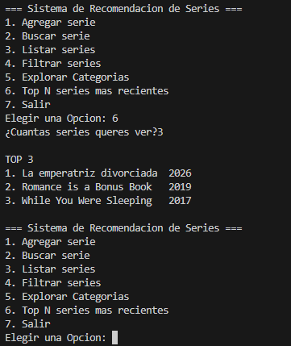
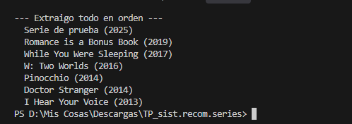
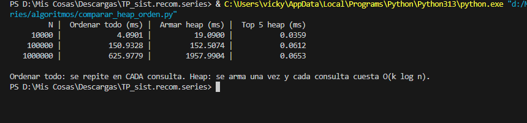

# Análisis — Cola de prioridad (Heap) — Versión 4

## 1. ¿Qué resolvimos?
Un ranking dinámico de series: el sistema devuelve las N series de mayor prioridad
(Top N) y se mantiene actualizado cuando se agrega una serie nueva.
Se usa en la opción 6 del menú, "Top N series más recientes".

## 2. Función de prioridad
```python
def prioridad(serie):
    return serie.año
```
Elegimos **más reciente primero**, por año de estreno. No requiere datos nuevos
y es objetivo. La heap no conoce el criterio: solo compara lo que devuelve
`prioridad`, así que se puede cambiar (por ejemplo a rating) sin tocar la heap.

## 3. La heap (`estructuras/heap.py`)
Heap binaria de máximos implementada a mano (sin `heapq`), guardada en una lista:
para el nodo i, hijo izquierdo en 2i+1, derecho en 2i+2, padre en (i-1)//2.

| Operación | Complejidad |
|---|---|
| insertar | O(log n) |
| extraer máximo | O(log n) |
| ver máximo | O(1) |
| armar desde una lista | O(n) |
| Top-k | O(k log n) |

## 4. Prueba
Salida de `python algoritmos/probar_heap.py`: la extracción completa devuelve las
series de año mayor a menor (2025, 2019, 2017, 2016, 2014, 2014, 2013) aunque se
hayan cargado sin orden. (Captura en `docs/capturas/`.)

En el menú, al agregar "La emperatriz divorciada" (2026), pasó a ser la primera
del Top 3 sin reiniciar el programa.

## 5. ¿Por qué heap y no ordenar todo cada vez?
Datos reales de `algoritmos/comparar_heap_orden.py`, Top 5, años aleatorios:

| N | Ordenar todo (ms) | Armar heap (ms) | Top 5 con heap (ms) |
|---|---:|---:|---:|
| 10.000 | 4.0901 | 19.0900 | 0.0359 |
| 100.000 | 150.9328 | 152.5074 | 0.0612 |
| 1.000.000 | 625.9779 | 1957.9904 | 0.0653 |

- Ordenar todo cuesta O(n log n) **en cada consulta**. La heap se arma una vez
  (O(n)) y cada consulta cuesta O(k log n).
- Armar la heap tarda más que una ordenada porque `sorted` está implementado en C
  y nuestra heap en Python. Aun así, se recupera: con 10.000 series conviene a
  partir de la 5ª consulta, con 100.000 a partir de la 2ª y con 1.000.000 a partir
  de la 4ª.
- Al agregar una serie nueva, la heap la acomoda en O(log n); ordenar todo
  obligaría a reordenar el dataset completo.

## 6. Conclusión
Para un ranking que se consulta seguido y cuyo catálogo crece, la heap es la
estructura adecuada: el costo de armarla se paga una vez y cada Top N cuesta
casi lo mismo sin importar el tamaño del dataset (0.036 ms con 10.000 series y
0.065 ms con 1.000.000). Ordenar todo solo conviene si se necesita la lista completa
ordenada o se consulta una única vez.

## 7. Errores o dudas que tuvimos
- Al integrar la heap, la opción "Agregar serie" seguía usando solo el gestor: la
  serie nueva no aparecía en el Top N. Lo resolvimos insertando la misma serie en
  la lista, el AVL y la heap.
- Nuestro primer `top_n` copiaba toda la heap en cada consulta (O(n)), lo que
  contradecía el O(k log n) esperado. Lo cambiamos para extraer los k mayores y
  volver a insertarlos, sin copiar.

## 8. Datos y evidencia
- `estructuras/heap.py`: heap de máximos.
- `algoritmos/probar_heap.py`: prueba aislada.
- `algoritmos/comparar_heap_orden.py`: comparación de tiempos.
- `docs/capturas/`: capturas de la terminal y del menú.






