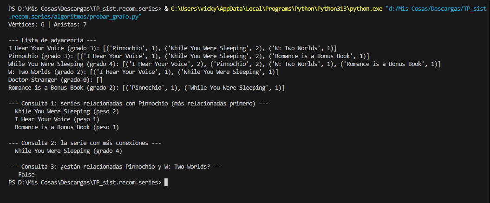
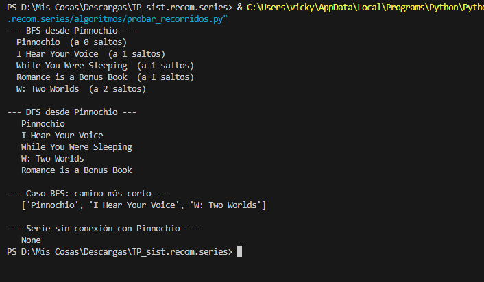
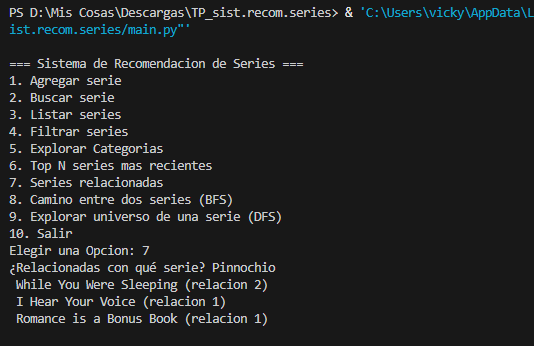
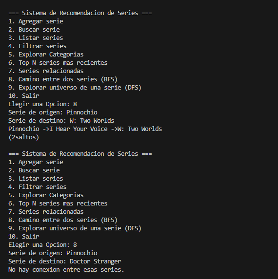
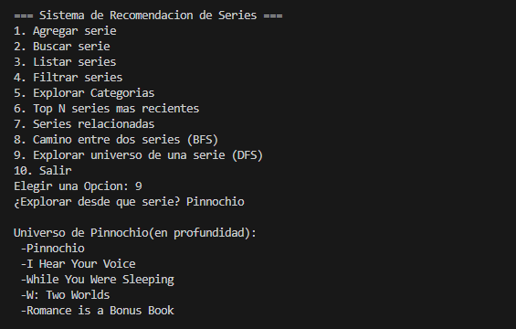
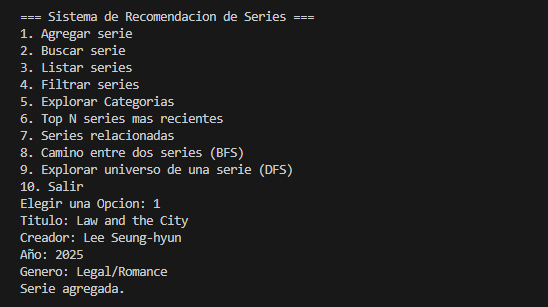
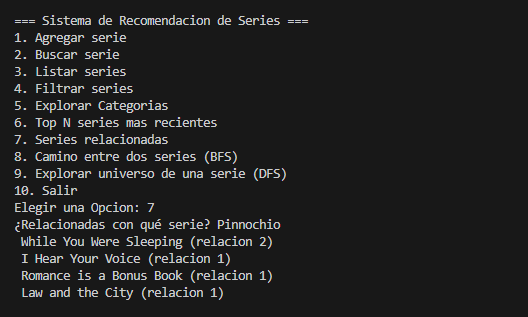

# Análisis — Grafos y Recorridos (versiones 5 y 6)

## 1. Modelo del grafo
- **Vértice:** una serie, identificada por su título.
- **Arista:** dos series están conectadas si comparten creador o al menos un género.
- **Tipo:** no dirigido (si A se parece a B, B se parece a A) y pesado.
  Peso = cantidad de coincidencias: 1 si comparten creador + 1 por cada género compartido.
- **Representación:** lista de adyacencia, implementada como diccionario de diccionarios
  (`{serie: {vecino: peso}}`).

**Por qué lista y no matriz:** la lista ocupa O(V + E) y la matriz O(V²), con casi todas
las celdas en 0 porque cada serie se relaciona con pocas. Además, nuestras consultas
("¿con qué series se relaciona X?") y los recorridos solo necesitan los vecinos de un
vértice: con lista cuesta O(grado), con matriz habría que revisar una fila completa, O(V).

## 2. Prueba del grafo
Salida de `python algoritmos/probar_grafo.py`: 6 vértices y 7 aristas.

```
I Hear Your Voice (grado 3): [Pinnochio 1, While You Were Sleeping 2, W: Two Worlds 1]
Pinnochio (grado 3): [I Hear Your Voice 1, While You Were Sleeping 2, Romance is a Bonus Book 1]
While You Were Sleeping (grado 4): [I Hear Your Voice 2, Pinnochio 2, W: Two Worlds 1, Romance is a Bonus Book 1]
W: Two Worlds (grado 2): [I Hear Your Voice 1, While You Were Sleeping 1]
Doctor Stranger (grado 0): []
Romance is a Bonus Book (grado 2): [Pinnochio 1, While You Were Sleeping 1]
```

- La serie más conectada es *While You Were Sleeping* (grado 4).
- *Pinnochio* y *W: Two Worlds* no están conectadas directamente, aunque hay un camino
  de 2 saltos entre ellas.
- *Doctor Stranger* no comparte creador ni género con ninguna serie: es un vértice
  aislado, por lo que el grafo **no es conexo**.

(Captura: `docs/capturas/`)

## 3. BFS y DFS

| | BFS (anchura) | DFS (profundidad) |
|---|---|---|
| Qué hace | Visita por niveles: primero lo que está a 1 salto, luego a 2... | Se mete por un camino hasta el fondo y recién después vuelve |
| Estructura auxiliar | Cola | Pila (la recursión) |
| Camino más corto en saltos | Sí | No |
| Complejidad (lista de adyacencia) | O(V + E) | O(V + E) |
| Memoria extra | O(V) (la cola) | O(profundidad) (la pila) |

Con una matriz de adyacencia ambos pasarían a O(V²), porque obtener los vecinos de un
vértice obliga a recorrer una fila completa.

## 4. Casos de uso
Salida de `python algoritmos/probar_recorridos.py`:

```
BFS desde Pinnochio:
  Pinnochio (0 saltos), I Hear Your Voice (1), While You Were Sleeping (1),
  Romance is a Bonus Book (1), W: Two Worlds (2)

DFS desde Pinnochio:
  Pinnochio, I Hear Your Voice, While You Were Sleeping, W: Two Worlds, Romance is a Bonus Book

Camino más corto Pinnochio -> W: Two Worlds:
  ['Pinnochio', 'I Hear Your Voice', 'W: Two Worlds']

Camino hacia Doctor Stranger: None
```

- **BFS: camino más corto entre dos series.** BFS explora por niveles, así que la primera
  vez que llega a una serie lo hace por el camino con menos aristas.
- **DFS: explorar todo el universo de una serie.** Devuelve todas las series alcanzables
  desde una dada. DFS llegó a *W: Two Worlds* (2 saltos) antes que a *Romance is a Bonus
  Book* (1 salto) porque sigue un camino hasta el fondo antes de volver: esa es la
  diferencia con BFS.
- *Doctor Stranger* nunca aparece: no tiene aristas, así que no hay camino hasta ella.

## 5. Cuándo conviene cada uno
- **BFS** cuando importa la cercanía: camino mínimo, "las más cercanas primero".
- **DFS** cuando importa cubrir toda la red o saber qué está conectado con qué.
- BFS minimiza la cantidad de aristas, no la suma de pesos. Para el camino de menor
  peso total haría falta otro algoritmo (Dijkstra).
- Límite del DFS recursivo: la profundidad de la recursión puede llegar a V, y Python
  limita la recursión por defecto a ~1.000 llamadas. Con un grafo muy grande habría que
  hacerlo iterativo con una pila explícita.

## 6. Integración en el sistema
Opciones nuevas del menú de `main.py`:
- **7. Series relacionadas:** vecinos de una serie ordenados por peso.
- **8. Camino entre dos series (BFS):** camino con menos saltos.
- **9. Explorar universo de una serie (DFS).**

El grafo se construye al iniciar (O(n²), compara todos los pares) y al agregar una serie
nueva se actualiza en O(n), comparándola solo contra las existentes. Lo probamos agregando
"Law and the City" (2025, Legal/Romance): sin reiniciar, ya aparece relacionada con
*Pinnochio* (comparten el género Romance).


## 7. Errores o dudas que tuvimos
- BFS y DFS devolvían resultados vacíos: en el script de prueba escribimos "Pinocchio" y
  en el `series.json` el título es "Pinnochio". Como ese vértice no existía en el grafo,
  los recorridos no encontraban nada. Corregimos la grafía.
- Al agregar una serie, el grafo debe actualizarse **antes** de agregarla al gestor; si no,
  la serie se compararía consigo misma.

## 8. Evidencia
- `estructuras/grafo.py`, `relaciones.py`
- `algoritmos/recorridos.py`
- `algoritmos/probar_grafo.py`, `algoritmos/probar_recorridos.py`
- `docs/capturas/`
  
  
  
  
  
  
  