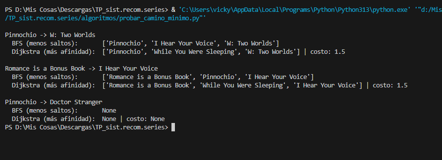
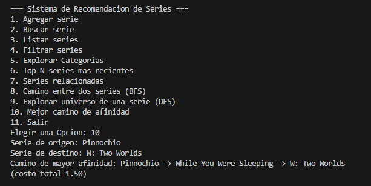

# Análisis — Optimización: camino de mayor afinidad 

> Nota: las salidas de este documento corresponden al catálogo inicial de 6 series.
> Para la demo se amplió `series.json` a 11 series, por lo que ahora `probar_grafo.py`
> muestra 11 vértices y 21 aristas, y la serie más conectada es *Pinnochio* (grado 8).
> Los caminos de ejemplo de BFS y Dijkstra se mantienen.

## 1. ¿Qué resolvimos?
Dadas dos series, encontrar la secuencia de series intermedias con la que se pasa
de una a otra de la forma más "cómoda": cada paso va a una serie lo más parecida
posible a la anterior.

## 2. Definición del costo
El peso de una arista mide cuánto se parecen dos series (cantidad de coincidencias
de creador y género). Para un camino mínimo hace falta lo contrario: que parecerse
mucho cueste poco. Definimos:

    costo de una arista = 1 / peso

El costo total de un camino es la suma de los costos de sus aristas. Menor costo
total = camino de mayor afinidad.

## 3. Algoritmo elegido: Dijkstra con heap

| Propiedad del grafo | Qué implica |
|---|---|
| Pesos | Todos los costos son positivos (una arista existe solo si el peso > 0, y el costo es 1/peso), así que Dijkstra es válido. Con pesos negativos habría que usar Bellman-Ford. |
| Dirigido o no | No dirigido: cada arista se recorre en ambos sentidos. Dijkstra funciona igual. |
| Densidad | Grafo ralo (cada serie se relaciona con pocas). La versión con heap evita recorrer todos los vértices en cada paso. |

La cola de prioridad es la heap que implementamos en la versión 4 (heap de máximos con
la distancia negada, para sacar primero la menor). Cada vértice se descarta si ya se
encontró un camino mejor para él.

**Ordenamiento topológico:** no lo incorporamos. Sirve cuando hay dependencias entre
elementos ("ver primero X para entender Y") y nuestro dominio no las tiene. Agregarlo
solo para cumplir iría contra la regla de que cada estructura debe resolver algo real.

## 4. Complejidad

| Variante | Complejidad |
|---|---|
| Dijkstra con heap (la nuestra) | O((V + E) log V) |
| Dijkstra con arreglo | O(V²) |
| BFS (para comparar) | O(V + E) |

Con heap se paga un factor log V por cada actualización de distancia, pero se evita
buscar el mínimo recorriendo todos los vértices. Como nuestro grafo es ralo (E mucho
menor que V²), conviene la versión con heap.

## 5. Caso de prueba
Salida de `python algoritmos/probar_camino_minimo.py`:

```
Pinnochio -> W: Two Worlds
  BFS (menos saltos):       ['Pinnochio', 'I Hear Your Voice', 'W: Two Worlds']
  Dijkstra (más afinidad):  ['Pinnochio', 'While You Were Sleeping', 'W: Two Worlds'] | costo: 1.5

Romance is a Bonus Book -> I Hear Your Voice
  BFS (menos saltos):       ['Romance is a Bonus Book', 'Pinnochio', 'I Hear Your Voice']
  Dijkstra (más afinidad):  ['Romance is a Bonus Book', 'While You Were Sleeping', 'I Hear Your Voice'] | costo: 1.5

Pinnochio -> Doctor Stranger
  BFS (menos saltos):       None
  Dijkstra (más afinidad):  None | costo: None
```

**Lectura:** BFS y Dijkstra encuentran caminos del mismo largo (2 saltos), pero BFS
elige el primero que encuentra, mientras que Dijkstra elige el de menor costo. En el
primer caso, pasar por *I Hear Your Voice* cuesta 1 + 1 = 2.0 y pasar por
*While You Were Sleeping* cuesta 0.5 + 1 = 1.5, porque *Pinnochio* y *While You Were
Sleeping* tienen peso 2 (comparten creador y un género). BFS minimiza la cantidad de
saltos; Dijkstra minimiza el costo total. *Doctor Stranger* no tiene aristas, así que
no hay camino hacia ella.

## 6. Integración
Opción 10 del menú, "Mejor camino de afinidad": pide una serie de origen y una de
destino y muestra el camino y su costo total, o avisa si no hay conexión.

## 7. Errores o dudas que tuvimos
En esta etapa no tuvimos errores relevantes: Dijkstra funcionó en la primera prueba
y el resultado coincidio.

## 8. Evidencia
- `algoritmos/camino_minimo.py`, `relaciones.py` (función `costo_arista`)
- `algoritmos/probar_camino_minimo.py`
- `docs/capturas/`


